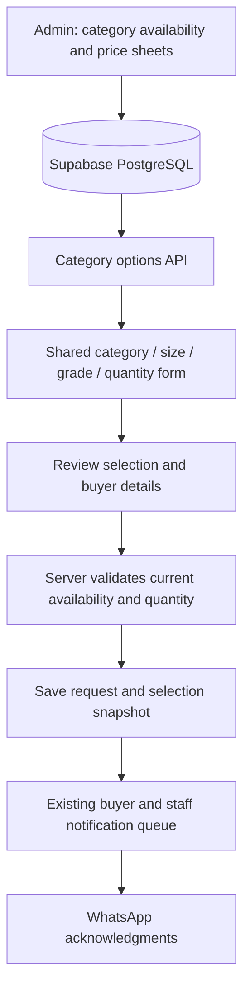

# Proposed material selection architecture

Status: implementation prepared locally following user approval. Final integrated verification is in progress; hosted migration, gateway deployment and application release are pending.

## Customer flow

Category → category-specific size → available grade → quantity with unit → review → submit request.

Keep selection on the catalogue page. Allow selection before signing in; preserve the draft through sign-in and return to review. Collect buyer and delivery details at review. Show a reference after the server accepts the request. One component owns the selection state; product details reuse that component with a preselected product.

Fasteners and Tractor Parts can appear in the category chooser, but use their own fields and existing quote/purchase behavior. Do not send them to the steel-only raw-material request function.

## System shape

Keep the existing Expo app, catalogue Edge Function gateway, PostgreSQL and notification worker. No separate service is required.

## Availability and pricing

Availability answers whether a particular product, size and grade can be requested. Pricing answers which published rate applies to that combination. Store and manage these independently.

Retain `catalog.categories`, `catalog.products`, `catalog.product_variants` and `catalog.category_grade_sheets`. Preserve current historical references and category-specific price sheets.

Proposed additional entities:

| Entity | Purpose |
| --- | --- |
| Category specifications | Fields and labels needed for that category: diameter, thickness, width, length or part/model; unit and display order. |
| Category sizes | Stable size identifier, customer label, typed/validated dimensions, category reference and active status. |
| Availability options | Explicit allowed product + size + grade combination, unit, MOQ and enabled status. Unique combination constraint; references to existing product/variant where applicable. |

Use foreign keys and server validation. Keep availability administration staff-only. Public reads expose enabled, published options; customer requests remain private. Do not automatically publish every possible size/grade combination for a category.

For round bars, preserve the approved 36 sizes and latest 34-grade sheet. Keep the 16–50 mm and 53–80 mm price groups with their existing additions. Show “Request quote” when an allowed combination has no published rate. The new option model should eventually remove the need to manufacture a variant solely to represent missing pricing; retain existing quote-only variant IDs for historical references.

Other categories must have their actual availability approved. The template's TMT and Sheet rows are examples until confirmed. Do not equate grade codes such as EN-8, EN-8D and EN-8DCR without an explicit business mapping.

## Form behavior

- Category change clears dependent size, grade and quantity selections.
- Size change clears grade and revalidates quantity/MOQ.
- Grade change revalidates unit, MOQ and quantity.
- Disable downstream controls until their required selection is valid.
- Display the category's dimension label: Diameter for round bars/TMT; Thickness for Sheet; suitable width/thickness or side dimensions for Flat/Square.
- Show the actual quantity unit beside the field. MT is a quantity unit; PMT is a price presentation label.
- Keep the draft in one owner and persist it through sign-in. Do not put buyer/delivery details in route parameters.
- Submit one selected option and quantity; the backend resolves current availability and pricing.

## Proposed API additions

These names are proposals, not existing APIs:

- `fti_catalog_selection_options(p_category, p_size_id)` returns category field metadata, enabled sizes, grades allowed for the chosen size, and opaque option IDs with units and MOQ. This replaces downloading every product/variant to build dropdowns.
- `fti_catalog_selection_request_submit(p_id, p_option_id, p_quantity, p_buyer)` resolves the selection server-side, validates its current status, snapshots customer-visible specifications and pricing state, creates the request and queues existing notifications in one transaction.

Continue to use `catalogApi.rpc` and the catalogue gateway. Keep the existing `fti_catalog_raw_order_submit` contract during migration. Add an adapter for the new options instead of changing old request identifiers in place. Preserve verified identity, staff permission checks, WhatsApp consent, request deduplication and delivery replay behavior.

## Implementation phases

### Phase 0 — documentation and current behavior

Read the following checked local sources before implementation:

- `src/features/catalog/screens/CatalogueScreen.tsx`: dependent selectors and clear behavior.
- `src/features/catalog/components/CatalogFilter.tsx`: existing accessible selector.
- `src/features/catalog/components/RawMaterialOrder.tsx`: quantity, buyer, consent, idempotency and submission pattern.
- `src/features/catalog/hooks/use-available-filters.ts` and `model/available-filters.ts`: current client-side enumeration and global size constraint.
- `src/features/catalog/data/catalog-repository.ts`: `catalogApi.rpc` gateway and catalogue reads.
- `supabase/migrations/202610230001_raw_material_orders.sql`: server request validation, snapshots and notification jobs.
- `supabase/migrations/202610240001_round_bar_availability.sql`: exact round-bar availability and price-group preservation.
- Expo SDK 57 reference: https://docs.expo.dev/versions/v57.0.0/ and Router reference: https://docs.expo.dev/versions/v57.0.0/sdk/router/.

Allowed existing contracts: `useAvailableFilters(category, size?)`, `catalogApi.rpc(operation, args)`, `fti_catalog_filtered_list(...)`, `fti_catalog_product_get(p_id)`, and `fti_catalog_raw_order_submit(p_id,p_variant,p_size,p_quantity,p_buyer)`. Treat all proposed contracts above as new work requiring migrations, permissions and gateway allowlist updates.

Verification: confirm repository versions and latest migrations; inspect actual hosted availability before planning a production data migration. Guard: never assume screenshot examples are complete stock data.

### Phase 1 — category-specific availability

Add category dimensions and explicit availability options. Start by adapting current round-bar data with stable mappings to existing product/variant IDs. Support Sheet thicknesses below 8 mm without changing the Round Bar size list. Keep pricing components in current private grade sheets.

References: baseline catalogue schema, round-bar availability migration and current grade-sheet models.

Verification: constraints reject duplicate/invalid combinations; public reads hide disabled options; staff permissions protect writes; order history remains readable; existing prices and price additions are identical before/after. Guard: no global numeric size whitelist and no automatic Cartesian product for unconfirmed categories.

### Phase 2 — compact server options

Implement the proposed options RPC using the existing gateway/repository pattern. Return size-specific grades and quantity constraints before UI pagination. Use indexed category/product/size/grade references.

References: `catalog-repository.ts`, current filtered-list RPC and gateway operation validation.

Verification: category isolation, size-dependent grades, empty categories, inactive entries, decimal dimensions and anonymous read permissions. Guard: do not fetch all catalogue pages just to populate a dropdown.

### Phase 3 — shared inline selector

Reuse `CatalogFilter` and the current dependent reset behavior. Extract selection state and quantity from the product-specific order form into a reusable selection component. Host it on the catalogue page and reuse it on product details. Keep category-specific input policies for steel, fasteners and tractor parts.

References: `CatalogueScreen.tsx`, `RawMaterialOrder.tsx`, `ProductDetailScreen.tsx` and Expo Router SDK 57 documentation.

Verification: category/size/grade changes cannot retain an invalid dependent selection; units and MOQ change correctly; mobile controls fit and work with the keyboard; a sign-in round trip preserves the draft. Guard: no duplicated independent selector state on the same page.

### Phase 4 — review and request submission

Reuse the existing raw-order transaction and notification behavior behind the proposed option-based submission adapter. Revalidate active availability, unit, MOQ and published pricing state on the server; snapshots retain what was requested. Requests awaiting price confirmation stay labelled as such.

References: raw-material submit RPC, request/job tables and current order form's request UUID handling.

Verification: availability removed after selection is rejected; quantity/MOQ violations are rejected; retries with one request ID create one request and one set of jobs; private requests cannot be read by other buyers. Guard: do not trust a client-supplied price or treat a quote request as a confirmed sale.

### Phase 5 — final verification and rollout

Run relevant database and UI tests, lint, typecheck and build. Exercise Round Bar, Bright Bar, TMT and Sheet; verify historical requests and current price sheets. Inspect mobile and desktop results. Release additive database/API support before the consuming UI; retain the previous submit API during rollout.

Guard: do not remove compatibility columns or old variant IDs during the initial release. Hosted availability and notification delivery require environment-specific verification beyond local mocked browser tests.

## Implementation locations

- `supabase/migrations/202610240002_material_selection.sql`: category dimensions, explicit sizes and combinations, public options API, staff editing and validated request submission.
- `src/features/catalog/components/MaterialAvailabilityAdmin.tsx`: staff category dimensions, decimal sizes, price links, MOQ and enable/disable controls.
- `src/features/catalog/model/material-availability-admin.ts`: client-side dimension and MOQ validation.
- `src/features/catalog/screens/CatalogManagement.tsx`: staff availability editor entry point.
- `tests/material-selection-db.test.ts`: database availability, authorization, pricing and request lifecycle coverage.
- `tests/material-availability-admin.test.ts`: decimal, dimension-boundary and linked-MOQ validation.
- `scripts/material-selection-admin-browser.py`: isolated staff editor browser acceptance flow.

Customer selection components and final release checks are being integrated alongside these files. Deployment instructions are maintained in `docs/material-selection-deployment.md`.
